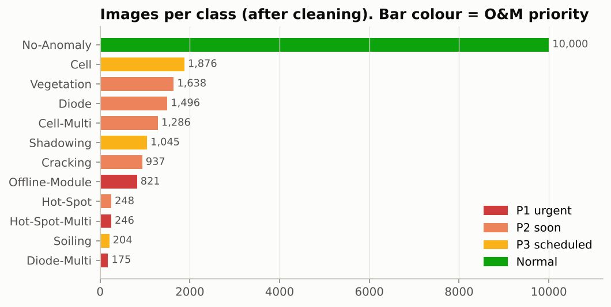
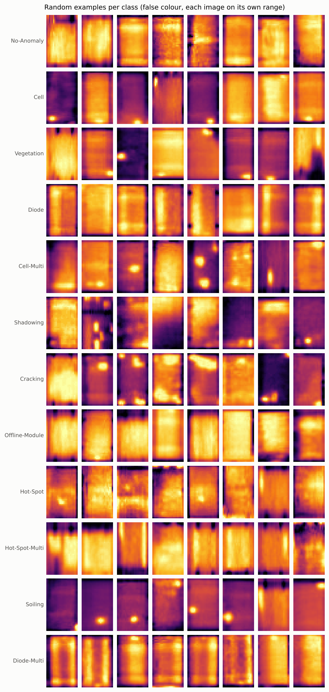
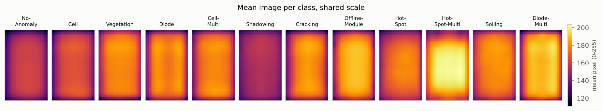
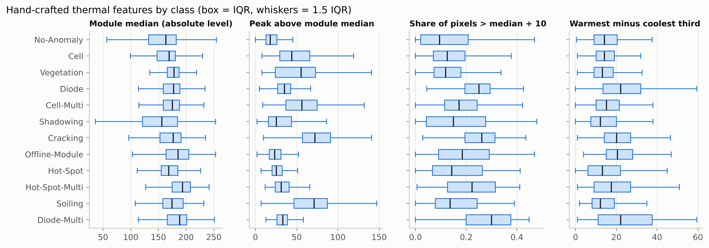
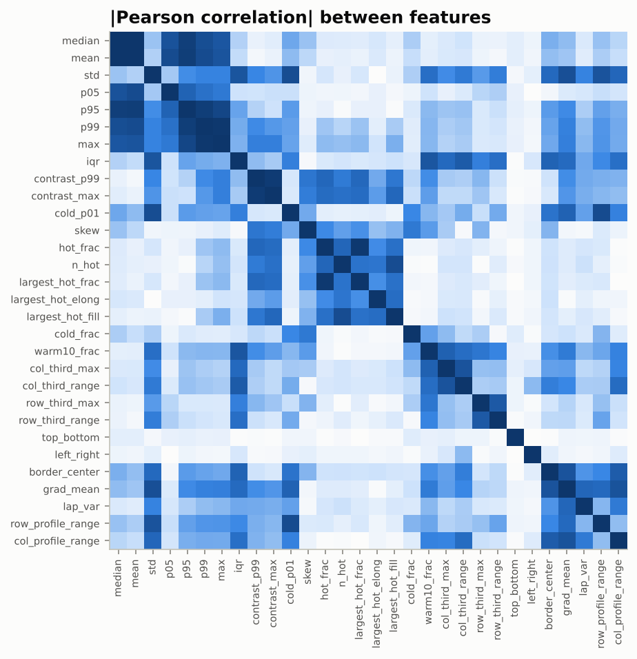

# Exploratory data analysis: InfraredSolarModules

Generated by `python training/eda.py` from the cleaned dataset (`training/prepare_data.py`).

## Data quality

- Images in metadata: **20,000**, all 24 x 40 px, 8-bit greyscale.
- Exact pixel duplicates: **22 groups**. **6** of them carry *different* labels for identical pixels (dropped: 12 images). The other 16 redundant copies were dropped so no image sits in both train and test.
- Kept: **19,972** images. Split 70/15/15 stratified by class (seed 42): train 13,981, val 2,996, test 2,995.
- The class counts in the dataset README differ from `module_metadata.json` by 1-2 images in five classes; this project uses the JSON.
- Conflicting-label pairs (image id, label): 161 Offline-Module / 4518 Cell-Multi; 450 Offline-Module / 7484 Cracking; 483 Offline-Module / 6888 Hot-Spot; 543 Offline-Module / 5171 Cell; 1124 Diode / 7387 Cracking; 3915 Cell-Multi / 7027 Cracking.

## Class balance

Half the images are normal modules. Among the anomalies, three classes have fewer than 260 images (Hot-Spot, Hot-Spot-Multi, Soiling) and Diode-Multi has 175, so per-class metrics on those are noisy (about 26-38 test images each).

| Class | Images | Train | Val | Test | Median module level | Peak above median | Pixels > median+10 (%) | Has a hot spot (%) |
|---|---:|---:|---:|---:|---:|---:|---:|---:|
| No-Anomaly | 10,000 | 7,000 | 1,500 | 1,500 | 163 | 18 | 9.4 | 3 |
| Cell | 1,876 | 1,313 | 281 | 282 | 169 | 44 | 12.4 | 53 |
| Vegetation | 1,638 | 1,147 | 246 | 245 | 178 | 55 | 11.8 | 56 |
| Diode | 1,496 | 1,047 | 224 | 225 | 177 | 35 | 24.9 | 4 |
| Cell-Multi | 1,286 | 900 | 193 | 193 | 175 | 56 | 17.1 | 56 |
| Shadowing | 1,045 | 732 | 157 | 156 | 156 | 25 | 14.8 | 21 |
| Cracking | 937 | 656 | 141 | 140 | 176 | 72 | 26.1 | 54 |
| Offline-Module | 821 | 575 | 123 | 123 | 185 | 23 | 18.4 | 2 |
| Hot-Spot | 248 | 174 | 37 | 37 | 168 | 25 | 14.2 | 7 |
| Hot-Spot-Multi | 246 | 172 | 37 | 37 | 193 | 31 | 22.2 | 6 |
| Soiling | 204 | 143 | 31 | 30 | 174 | 71 | 13.6 | 71 |
| Diode-Multi | 175 | 122 | 26 | 27 | 188 | 33 | 29.9 | 2 |

## What the images show

Averaging each class on one shared colour scale separates the *whole-module* faults from the *local* ones. Hot-Spot-Multi, Diode-Multi and Offline-Module are warmer across the whole module, Diode shows faint vertical bands (the bypassed substring sits in a different third in each image), Shadowing is cooler than normal, and single-cell faults average out because the hot cell moves from image to image.

Where is the hottest pixel? For **Vegetation** it is in the bottom quarter of the module in 63% of images, against 29% for normal modules: plants shade the lowest cells, which then heat up. Single-cell hot spots show the same bias.

| Class | Hottest pixel in bottom quarter (%) | in top quarter (%) |
|---|---:|---:|
| No-Anomaly | 29 | 30 |
| Cell | 58 | 21 |
| Vegetation | 63 | 15 |
| Diode | 24 | 36 |
| Cell-Multi | 47 | 22 |
| Shadowing | 29 | 39 |
| Cracking | 26 | 30 |
| Offline-Module | 26 | 35 |
| Hot-Spot | 13 | 12 |
| Hot-Spot-Multi | 9 | 13 |
| Soiling | 17 | 42 |
| Diode-Multi | 27 | 43 |

## Features

Thirty hand-crafted features (`src/solar_inspector/features.py`) describe level, contrast, hot-region size and shape, and where on the module the heat sits (thirds, halves, border).

Best single features for *anomaly vs normal* (ROC-AUC of the raw feature, no model):

| Feature | AUC | Direction |
|---|---:|---|
| `contrast_max` | 0.838 | higher = anomaly |
| `contrast_p99` | 0.816 | higher = anomaly |
| `max` | 0.797 | higher = anomaly |
| `p99` | 0.762 | higher = anomaly |
| `grad_mean` | 0.697 | higher = anomaly |
| `std` | 0.692 | higher = anomaly |
| `lap_var` | 0.690 | higher = anomaly |
| `p95` | 0.686 | higher = anomaly |

The best single feature (peak contrast) reaches about 0.84 AUC: useful, but far from enough to send technicians on, which is why the features are combined in a model. Many features are strongly correlated (percentiles, contrast measures); that matters for linear models, not for the tree ensemble used as the feature baseline.

## Implications for modelling

1. **Absolute level matters.** Offline-Module and Diode-Multi modules are warmer overall, not locally. Per-image normalisation would erase that signal, so the CNN sees raw 0-255 values. The catch: absolute level depends on how each flight's camera scaled temperature to 8 bits. In production, compare each module against its neighbours on the same flight (the API reports `delta_vs_batch` for this).
2. **Imbalance.** Train with class weights, and report macro-F1 and per-class recall, not just accuracy.
3. **Flip symmetry.** A module flipped left-right or upside-down is the same fault, so flips are safe augmentation. Rotations are not (a diode third would turn into a horizontal band).
4. **Small rare classes.** Treat per-class numbers for the four smallest classes as indicative.
