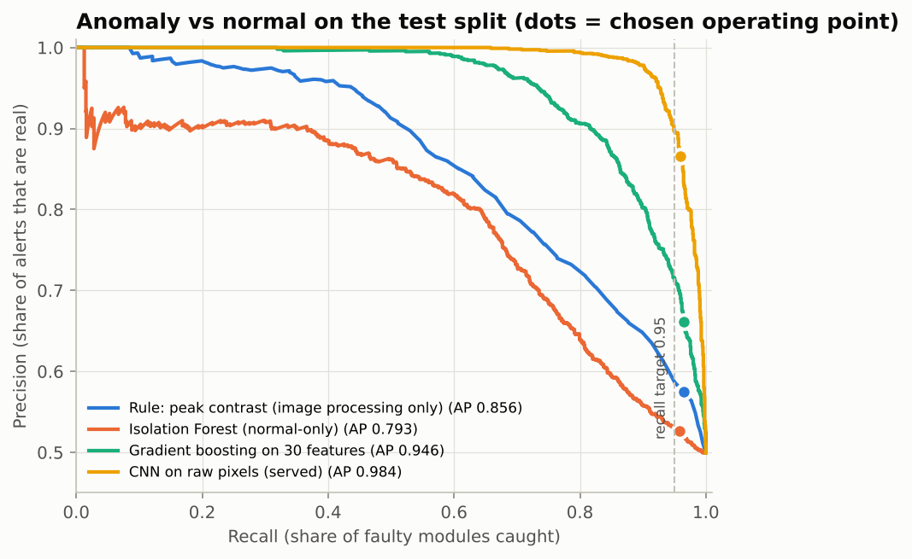
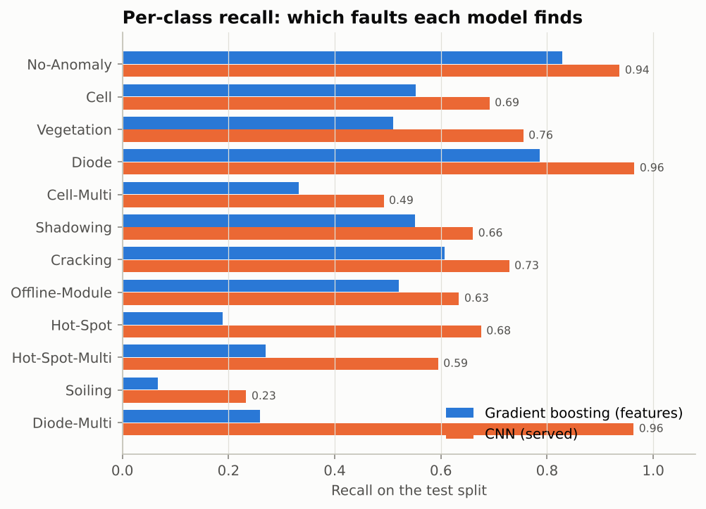
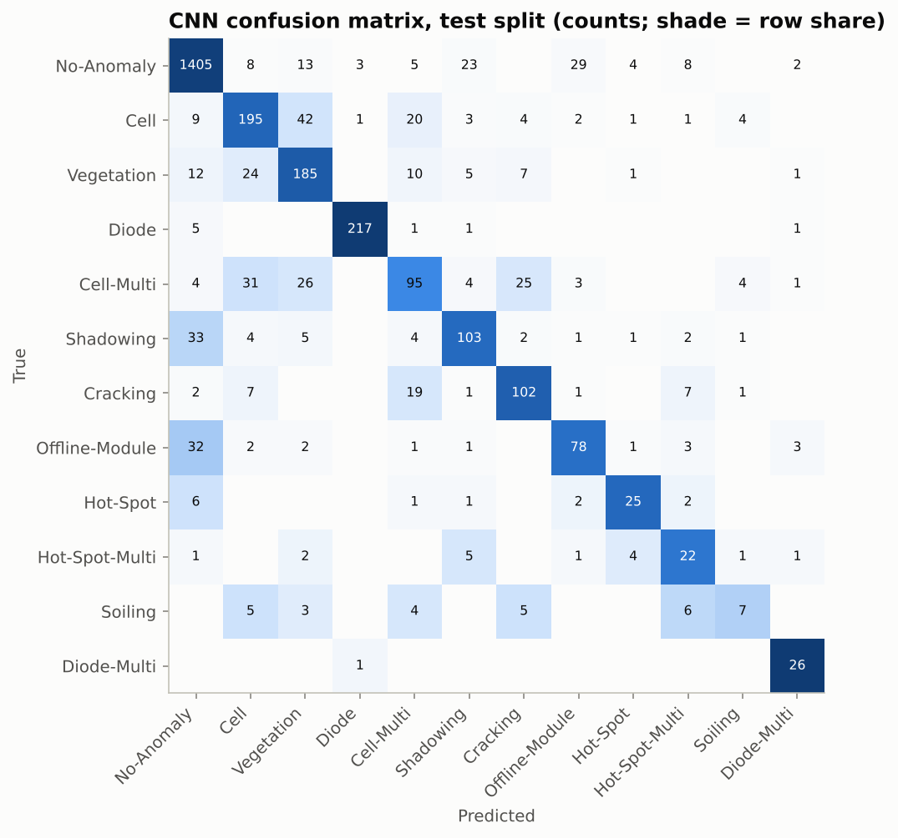

# Model evaluation

Generated by `python training/evaluate.py` on 2026-10-26. Served model: `cnn-dbb19326af`.

Test split: **2,995 images** (1,495 anomalous, 1,500 normal), never used for training, model selection or threshold choice.

## 1. Can it find faulty modules? (anomaly vs normal)

Each model's alert threshold was set on the **validation** split to catch at least 95% of faulty modules, then applied once to the test split.

| Model | ROC-AUC | PR-AUC | Recall | Precision | False-alarm rate | Critical faults missed |
|---|---:|---:|---:|---:|---:|---:|
| Rule: peak contrast (image processing only) | 0.842 | 0.856 | 0.965 | 0.575 | 0.711 | 13 of 412 |
| Isolation Forest (normal-only) | 0.779 | 0.793 | 0.959 | 0.526 | 0.859 | 20 of 412 |
| Gradient boosting on 30 features | 0.935 | 0.946 | 0.965 | 0.661 | 0.493 | 22 of 412 |
| CNN on raw pixels (served) | 0.980 | 0.984 | 0.959 | 0.866 | 0.148 | 22 of 412 |

*Critical* = Diode, Diode-Multi, Hot-Spot-Multi, Offline-Module (P1 priority or at least a third of the module's output lost).

## 2. Can it tell which fault it is? (12 classes)

| Model | Accuracy | Macro-F1 | Weighted-F1 | Top-2 accuracy | Calibration error (ECE) |
|---|---:|---:|---:|---:|---:|
| Gradient boosting on 30 features | 0.676 | 0.454 | 0.677 | 0.827 | 0.022 |
| CNN on raw pixels (served) | 0.821 | 0.683 | 0.820 | 0.928 | 0.024 |

**Calibration.** The CNN's probabilities are temperature-scaled (T = 0.7, fitted on validation log-loss), which cut validation ECE from 0.124 to 0.012 without changing any prediction. A displayed confidence of 80% is right about 80% of the time, which matters because confidence drives the *needs review* flag.

For context, published 12-class accuracies on this dataset are about 0.83-0.86 (ResNet-50 about 0.83, ResPNet 0.846, a 13-model ensemble 0.859; Sun & Li 2023). Their splits differ from this one, so treat the comparison as indicative.

| Class | Test images | Precision | Recall | F1 |
|---|---:|---:|---:|---:|
| No-Anomaly | 1500 | 0.931 | 0.937 | 0.934 |
| Cell | 282 | 0.707 | 0.691 | 0.699 |
| Vegetation | 245 | 0.665 | 0.755 | 0.707 |
| Diode | 225 | 0.977 | 0.964 | 0.971 |
| Cell-Multi | 193 | 0.594 | 0.492 | 0.538 |
| Shadowing | 156 | 0.701 | 0.660 | 0.680 |
| Cracking | 140 | 0.703 | 0.729 | 0.716 |
| Offline-Module | 123 | 0.667 | 0.634 | 0.650 |
| Hot-Spot | 37 | 0.676 | 0.676 | 0.676 |
| Hot-Spot-Multi | 37 | 0.431 | 0.595 | 0.500 |
| Soiling | 30 | 0.389 | 0.233 | 0.292 |
| Diode-Multi | 27 | 0.743 | 0.963 | 0.839 |

## 3. What it means in the field

The test split is 50% faulty modules; a real plant has far fewer. Precision falls as faults get rarer, because false alarms come from the (much larger) healthy population. Using the CNN's test recall (0.959) and false-alarm rate (0.148):

| Share of modules that are faulty | Expected precision of alerts |
|---:|---:|
| 1% | 0.06 |
| 2% | 0.12 |
| 5% | 0.25 |
| 10% | 0.42 |
| 50% | 0.87 |

Example: a 10,000-module survey with 5% faulty modules gives about **1,886 alerts**: 480 real faults caught, 20 missed and 1,406 false alarms. In practice the false alarms are cheap to clear because every alert comes with its image, and the dashboard's *false alarm* button records them for retraining.

**What the app reports.** The app first applies the recall-oriented threshold, then names the most likely fault class. Scored that way, the served decision has accuracy 0.788 and macro-F1 0.655 on the test split, below plain arg-max (0.821), because it deliberately raises borderline modules as faults rather than calling them normal.

**Alert policy.** Operators choose per deployment (`ALERT_POLICY`). *standard* is the single 95%-recall threshold. *safety* adds a second, lower bar on the summed probability of the critical classes, tuned on validation to catch 97% of them (bar = 0.063).

| Policy | Recall | False-alarm rate | Precision (test) | Precision at 5% faulty | Critical missed |
|---|---:|---:|---:|---:|---:|
| standard | 0.959 | 0.148 | 0.866 | 0.25 | 22 of 412 |
| safety | 0.977 | 0.315 | 0.756 | 0.14 | 8 of 412 |

Most missed critical faults are **Offline-Module** (class recall 0.63): a whole module running warm looks like a normal module on its own, and only stands out next to its neighbours. That is why each finding also reports *level vs batch*, and why *safety* is the better choice for sites where a dead module is expensive and a technician check is cheap.

**Human review routing.** Alerts whose top-class probability is below 0.5 are marked *needs review*. Of the 1,656 test alerts, 82% are confident and their fault label is right 72.5% of the time, against 33.0% for the alerts routed to review.

## 4. Robustness (CNN, same threshold)

| Perturbation | Accuracy | Macro-F1 | Recall | False-alarm rate |
|---|---:|---:|---:|---:|
| none | 0.821 | 0.683 | 0.959 | 0.148 |
| noise sd 5 | 0.706 | 0.489 | 0.799 | 0.019 |
| blur 3x3 | 0.796 | 0.634 | 0.946 | 0.129 |
| contrast x0.8 | 0.812 | 0.660 | 0.943 | 0.099 |
| offset -10 | 0.822 | 0.680 | 0.954 | 0.132 |
| offset +10 | 0.810 | 0.658 | 0.963 | 0.183 |

The weakest point is **noise sd 5**: recall falls from 0.959 to 0.799. Noisy frames (low irradiance, high gain, motion) should be re-flown or fed through review. Global brightness offsets of +/-10 grey levels, which mimic a flight with different 8-bit scaling, move recall by at most 0.005.

## 5. Speed

ONNX Runtime, CPU, 1 thread: **3.932 ms** per single image, 3.1 ms per image in batches of 256 (about 323 images/s). A 10,000-module site takes about 31 s on one thread (the API uses two), so upload and storage, not inference, set the pace.

The exported ONNX graph matches PyTorch to within 5.4e-07 (max absolute difference in probability).

## 6. Limitations

- **One data source.** All images come from one provider's pipeline; there are no site or flight IDs, so the split can't hold out whole sites. Expect lower numbers on a new site or camera until you fine-tune on a few hundred of its modules.
- **Non-radiometric input.** Pixel values are relative temperatures; the model can't give delta T in degrees C. The app accepts radiometric CSV/NPY matrices for that and flags them for review.
- **Label noise.** Six groups of identical images carried conflicting labels. That was removed, but near-duplicates with different labels may remain.
- **Rare classes** (Diode-Multi, Soiling, Hot-Spot, Hot-Spot-Multi) have 27-37 test images each, so their per-class numbers carry wide uncertainty.
